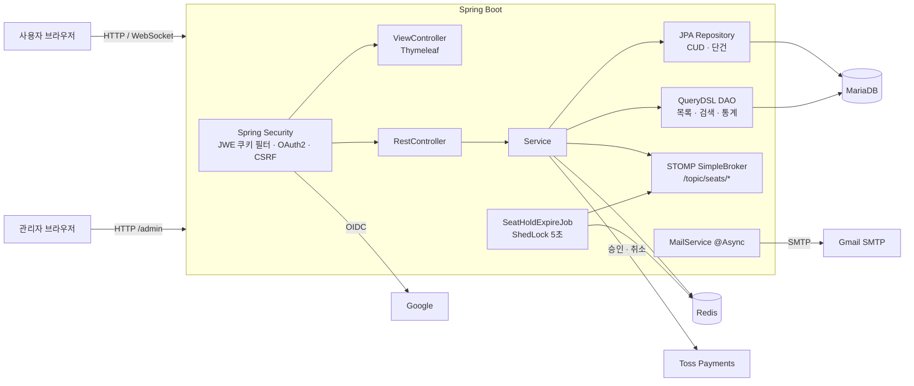

# 아키텍처

## 시스템 구성

## 레이어 역할

| 레이어 | 역할 | 규칙 |
| --- | --- | --- |
| Controller | 요청 바인딩, 응답 | 사용자 `/api/**`, 관리자 `/api/admin/**` |
| Service | 트랜잭션, 비즈니스 규칙, 검증 | `@ReadTx` / `@RequiredTx`, 실패는 `GlobalException.business()` |
| Repository (JPA) | 등록·수정·삭제, 단건 조회 | 엔티티 메서드로 상태 변경 (변경 감지) |
| DAO (QueryDSL) | 목록·검색·집계 | `Projections.bean`으로 DTO 직접 조회, `QueryDslHelper` 동적 조건 |
| DTO | 도메인별 1파일 + 용도별 inner class | `SearchReq`, `SearchRes`, `DetailRes`, `CreateReq`, `UpdateReq` |

외부 API(Toss) 호출은 트랜잭션 밖에서 하고, DB 저장은 별도 빈(`PaymentTxService`, `BookingCancelTxService`, `BookingSeatChangeTxService`)의 트랜잭션으로 분리했습니다.

## 보안

| 항목 | 내용 |
| --- | --- |
| 세션 | STATELESS |
| 토큰 | JWT를 JWE로 암호화해 쿠키 저장 (HttpOnly, SameSite=Lax, prod는 Secure). access 15분 / refresh 360분 |
| 토큰 갱신 | refresh 시 회원을 다시 조회해 정지·탈퇴 회원 차단 |
| 로그인 | `JwtAuthenticationFilter`, 로그인 성공·실패 이력 저장 |
| 소셜 | Google OIDC, `email_verified` 확인, 인가 요청은 Redis 저장소(세션 대신), 같은 이메일이면 기존 계정에 연결 |
| 인가 | `/admin/**`, `/api/admin/**` → `ADMIN`, `SUPER_ADMIN`. 사용자 API는 서비스에서 로그인 확인(`LOGIN_REQUIRED`) |
| CSRF | `csrf.spa()` — 쿠키 토큰, axios가 `X-XSRF-TOKEN` 헤더로 전송 |
| WebSocket | 허용 Origin = `app.base-url` |
| 리다이렉트 | `RedirectUtil`로 내부 경로만 허용 (오픈 리다이렉트 방지) |
| 비밀값 | 모든 키·비밀번호는 환경변수, Toss 클라이언트 키만 공개 |

## Redis 사용처

| 키 / 용도 | 이유 |
| --- | --- |
| `seat:hold:{inventoryId}:{seatNo}` (+ ZSET, SET) | 좌석 임시 선점. Lua 스크립트로 원자적 선점·해제, TTL 300초 |
| 예약 세션 | 결제 전 입력값과 서버 계산 금액을 DB에 남기지 않고 보관 |
| 예약번호 시퀀스 (`INCR`) | 다중 서버에서도 원자적 채번 |
| OAuth2 인가 요청 | STATELESS 유지 |
| 비밀번호 재설정 토큰 | TTL 기반 1회용 토큰 |

## 프론트 구조

- Thymeleaf Layout: 사용자 / 관리자 레이아웃 분리
- webpack이 `frontend/src/page/**`를 페이지별 엔트리로 빌드, manifest로 스크립트 주입 (local은 dev server)
- `core.js`: 공통 유틸·API 모듈을 필요할 때만 동적 import (`loadUtils`, `loadApis`)
- 이벤트 위임과 `<template>` 복제로 목록 렌더링
- `dialog-util`: 커스텀 모달 z-index 스택 관리 (모달 위 모달)
