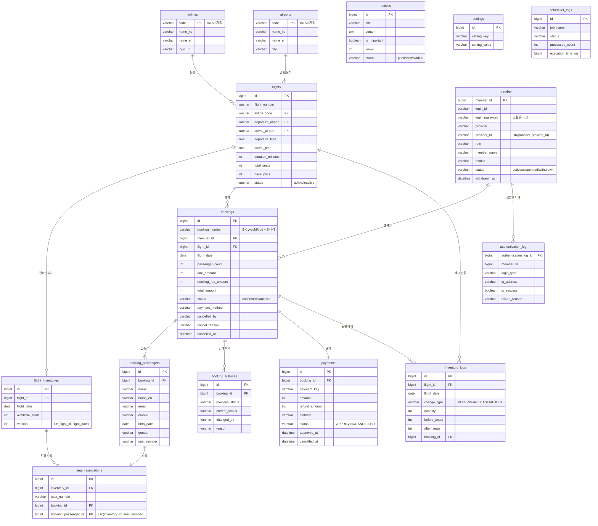

# ERD

엔티티 기준 (2026-10-28).

좌석 **선점**(결제 전)은 DB가 아니라 Redis에 있고, `seat_reservations`에는 결제가 끝난 **확정 좌석**만 저장됩니다.

## 핵심 제약

| 제약 | 이유 |
| --- | --- |
| `seat_reservations UK(inventory_id, seat_number)` | 같은 편·날짜·좌석의 중복 예약을 DB가 최종 차단 |
| `flight_inventories UK(flight_id, flight_date)` | 같은 날짜 재고 중복 생성 방지 (일괄 생성 시 있는 날짜는 건너뜀) |
| 재고 차감 `WHERE available_seats >= n` + `chk_available_seats >= 0` | 원자적 UPDATE로 초과 판매 방지, CHECK 제약이 음수 최종 차단 |
| `bookings UNIQUE(booking_number)` | Redis INCR 채번의 최종 안전망 |
| `member UK(provider, provider_id)` | 소셜 계정 중복 연결 방지 |
| `airlines`/`airports` 문자열 PK | IATA 코드가 자연키 |

## 상태값

| 테이블 | 상태 |
| --- | --- |
| flights | `active` / `inactive` (삭제 대신 운항중지 → 기존 예약 유지, 사용자 검색에서 제외) |
| bookings | `confirmed` / `cancelled` (결제 후 저장이라 pending 없음) |
| payments | `APPROVED` / `CANCELLED` (부분·전액 모두 CANCELLED, 금액은 `refund_amount`) |
| member | `active` / `suspended` / `withdrawn` |
| notices | `published` / `hidden` |
