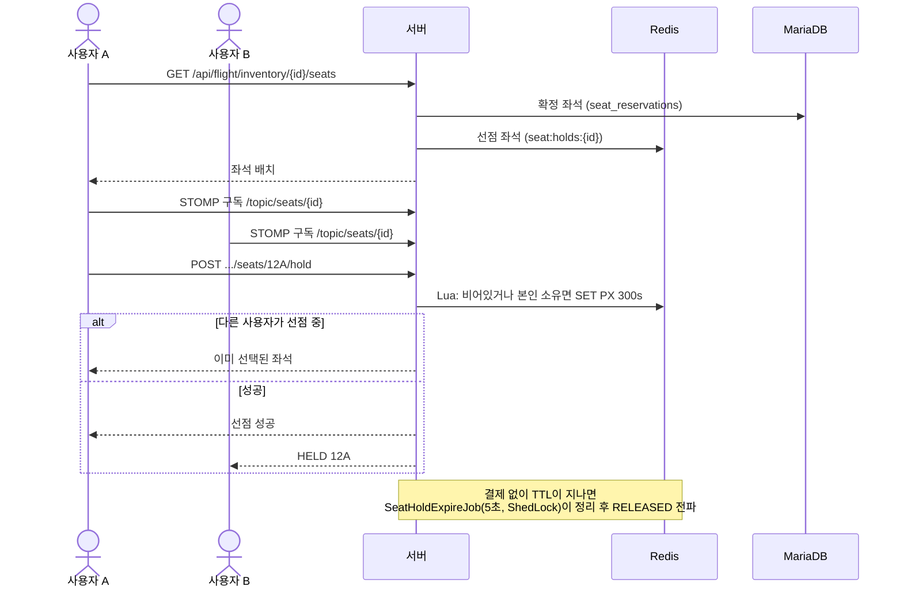
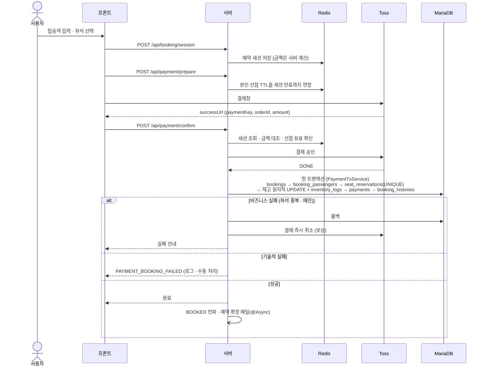
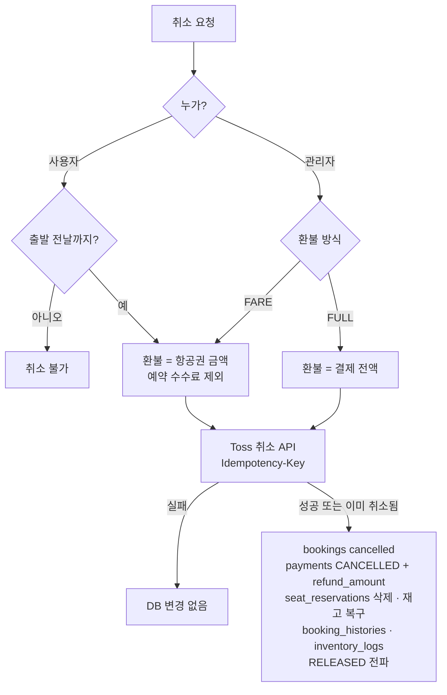
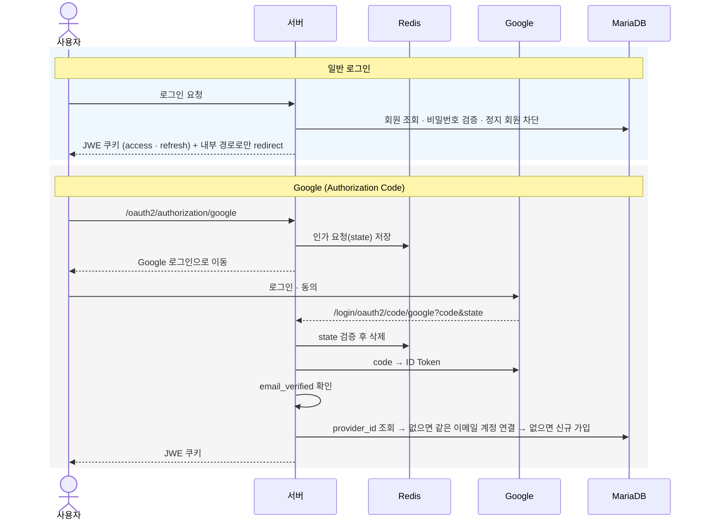

# 핵심 흐름

## 1. 좌석 선택 (Redis 선점 + WebSocket)

- 선점 해제: `DELETE .../seats/{seat}/hold` → 본인 소유일 때만 삭제 → `RELEASED`
- 결제 준비 시 본인 선점을 예약 세션 만료 시각까지 연장

## 2. 결제 → 예약 확정

- 같은 예약번호로 재호출(새로고침)하면 토스 재승인 없이 성공 응답

## 3. 예약 취소

## 4. 로그인 / Google 로그인

